# Assistant chat: live walks of both screens (2026-11-10)

The assistant engine and the two chat screens were built and tested apart: the engine on
scripted and live model runs, the screens on DOM tests and a headless browser with
scripted replies. This note records the two times the screens ran against the live
engine on that day: the first walk, what broke where the two meet and how it was fixed,
and the final walk on the engine and the screens as they are now. Live results and
simulated ones are kept apart, as in the other notes in this folder.

The screenshots are from the final walk.

| | Phone 390x844 | Desktop 1440x900 | Staff chat 1440x900 |
|---|---|---|---|
| A question with answers to tap | 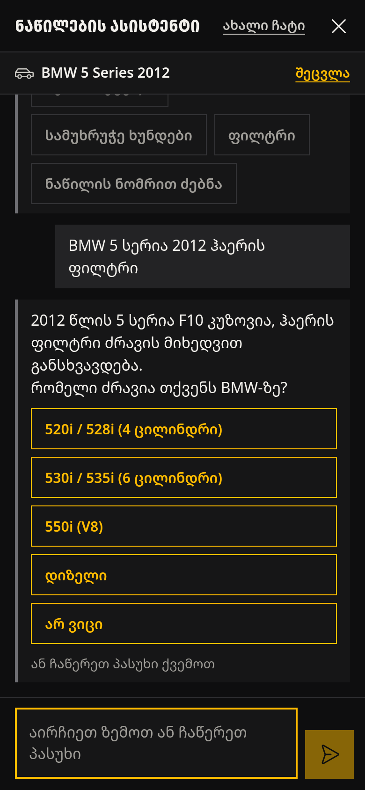 | 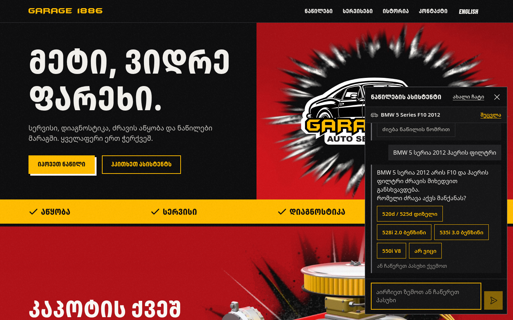 | 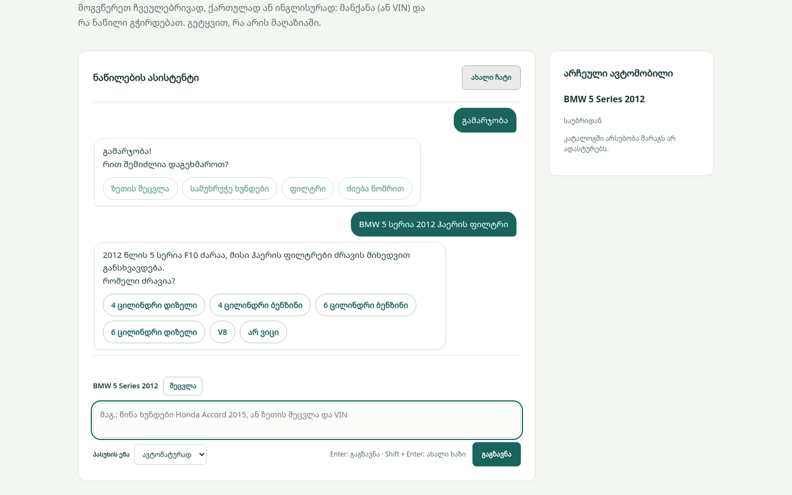 |
| The tapped answer stays marked while the reply is prepared | 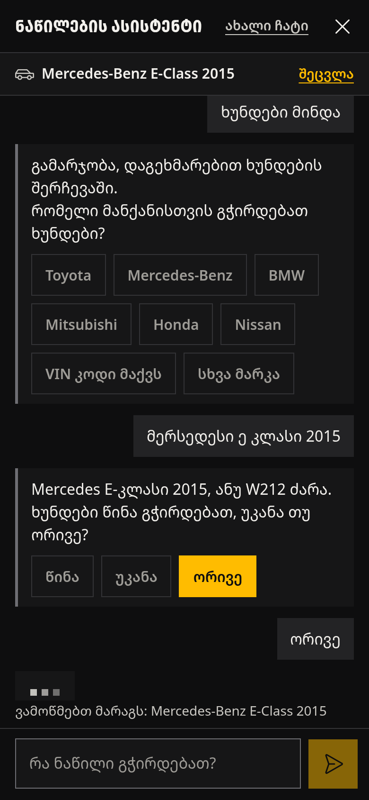 | | 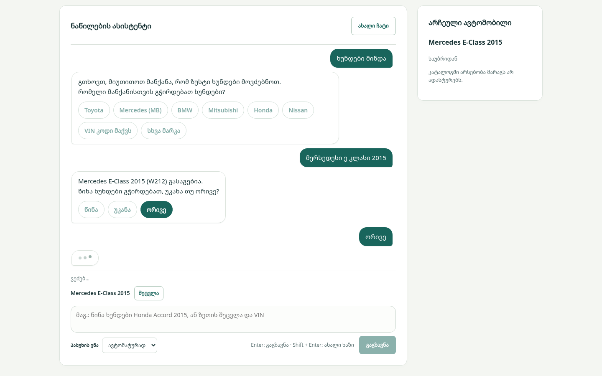 |
| Parts with price and availability, and one confidence line for each group | 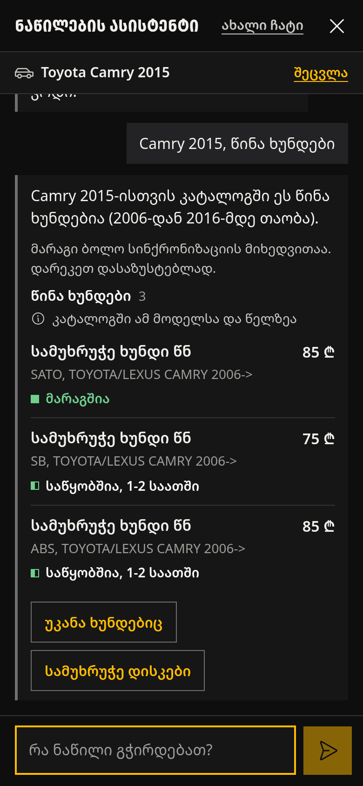 | 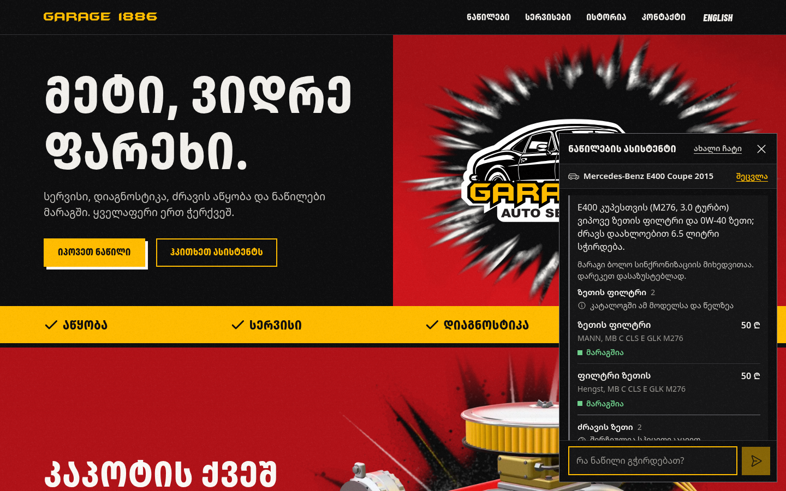 | 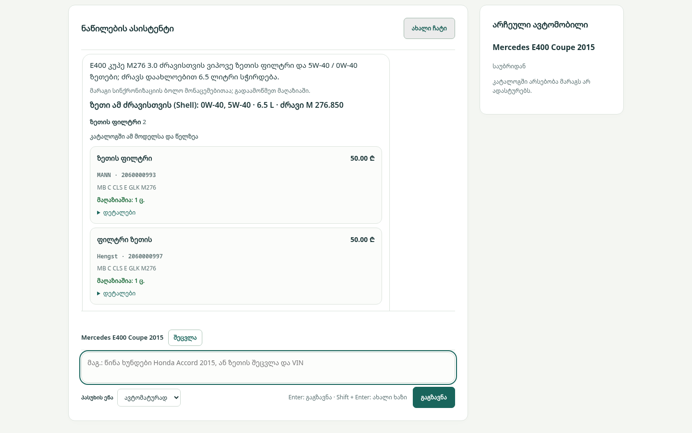 |
| Oils "chosen by specification" with the reason, and the answer to "not sure" | 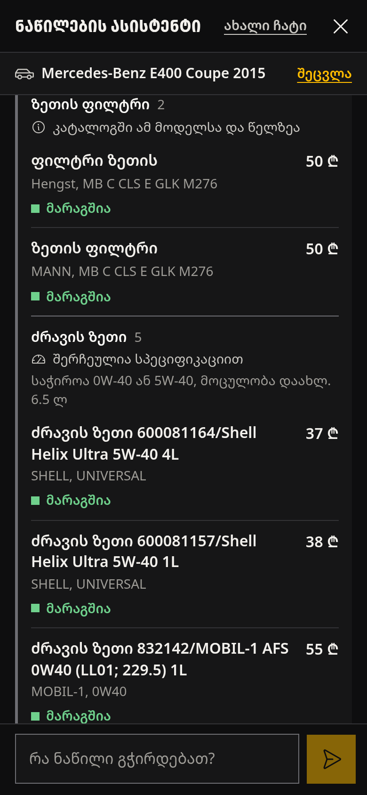 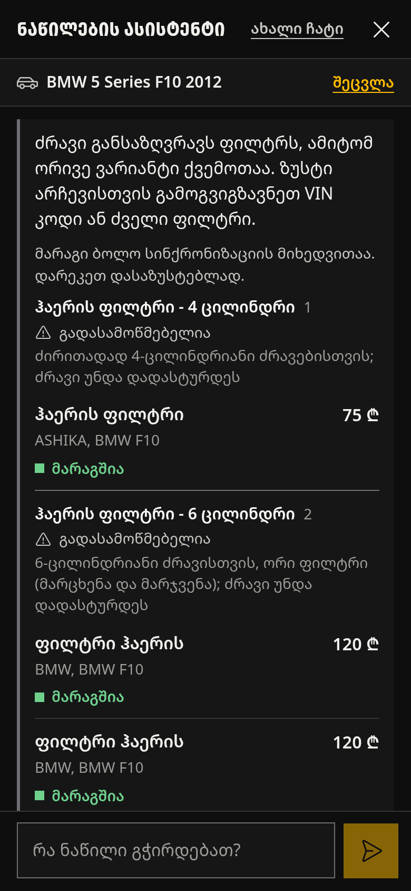 | | |
| Two groups, and the English page | 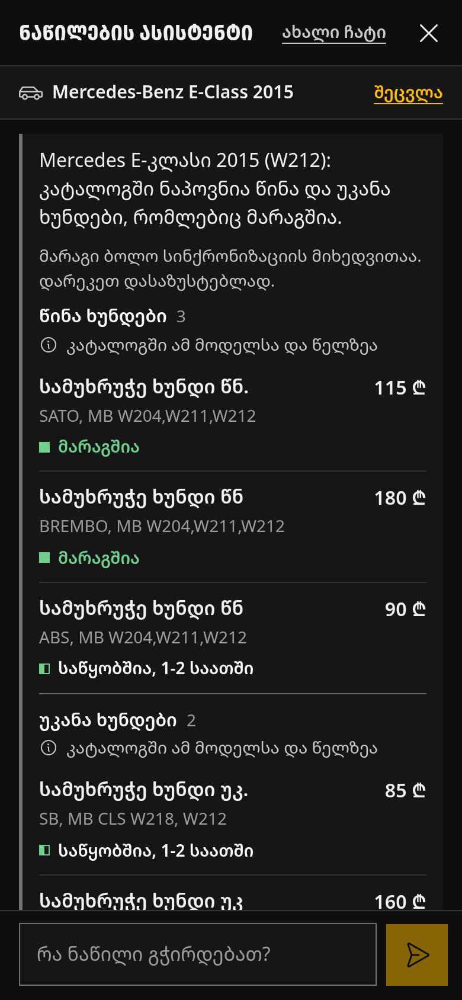 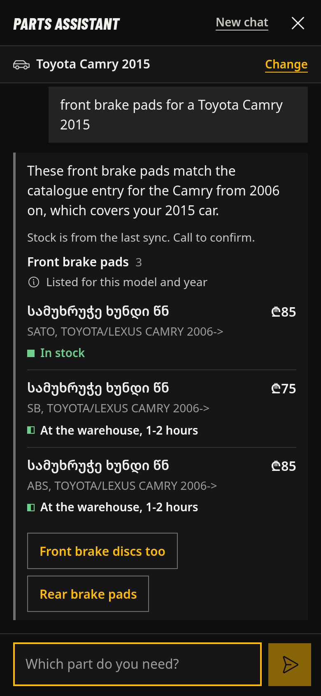 | | |

## How it was run

- A server of its own on port 8799, never the shop's on 8767, started with the staff
  login off (loopback only), both chat logs off (`AUTOMOTIVE_CHAT_LOG_PATH=` and
  `AUTOMOTIVE_SITE_CHAT_LOG_PATH=`, so no test turn entered the shop's logs; the log
  files were not modified during either walk), the paid catalogue key and the learned
  knowledge store off, and a source cache file of its own.
- The real catalogue of the dev database, read-only, and the real model: the assistant
  engine on `claude-sonnet-5-5`, effort `low`, thinking at the model's default. In the
  first walk the catalogue had 65,812 active rows, last synced 18 hours before.
- For the final walk every database session of that server was opened read-only, and
  the one thing a chat turn can write, a decoded VIN kept for thirty days, was switched
  off, so the made-up VIN left nothing behind. `AUTOMOTIVE_SITE_CHAT_DAILY_TURNS` was
  raised for that server, because the 25 widget turns of the walk, all from one address,
  come close to the 37 a day one address is allowed by default. The engine kept its
  prompt with the
  provider for an hour (`AUTOMOTIVE_ASSISTANT_CACHE_TTL=1h`, the default).
- Headless Chrome 151 driven by Playwright 1.59.1 through
  [`tests/browser/assistant_chat_walk.mjs`](../../tests/browser/assistant_chat_walk.mjs).
  The script is kept: its header says how to run it, that every message is a real model
  turn (about $0.03), and `WALK_DRY=1` tries it on scripted replies without a model.
- Screens: the public widget on the Georgian page `/` at 390x844 with touch and at
  1440x900, the English page `/en` at 390x844, and the staff chat at `/staff` at 1440x900.
- A typed message was sent three seconds after it was put in the composer, about as fast
  as anyone writes one. Seconds are counted from sending to the finished reply on screen.

## Final walk: conversations and seconds to the final reply

Each cell lists the turns of the conversation in order.

| Conversation | Phone | Desktop | Staff |
|---|---|---|---|
| a. `Camry 2015, წინა ხუნდები` | 9.5 | 8.5 | 8.9 |
| b. `მერსედესზე ე400 კუპეზე 2015 წლიანზე 3.0 ძრავით 2 ტურბინით მინდა ზეთის შეცვლა` | 13.5 | 13.5 | 20.0 |
| c. `ხუნდები მინდა`, then `მერსედესი ე კლასი 2015` typed, then "ორივე" (both) tapped | 3.9, 5.4, 9.5 | 3.4, 5.0, 8.4 | 4.9, 6.4, 9.0 |
| d. `გაქვთ 31835AA030?` | 3.9 | 3.5 | 4.9 |
| e. `გამარჯობა`, then `BMW 5 სერია 2012 ჰაერის ფილტრი`, then an engine tapped | 4.4, 7.9, 7.5 | 3.9, 8.0, 7.4 | 4.4, 7.4, 6.4 |
| f. `BMW 5 სერია 2012 ჰაერის ფილტრი`, then "არ ვიცი" (not sure) tapped | 10.4, 9.4 | | |
| vin. A made-up VIN, typed alone | 5.4 | | |
| form. The vehicle form holds a Honda Fit 2010; typed `Toyota Camry 2015 წინა ხუნდები` | | | 8.9 |
| English page: `front brake pads for a Toyota Camry 2015` | 7.9 | | |
| Second run. b again | 15.5 | | |
| Second run. g. `Camry 2015: წინა ხუნდები, უკანა ხუნდები და ზეთის ფილტრი`, then "2.5 ბენზინი" tapped | 13.5, 14.5 | | |

32 turns in the walk: median 7.5 s (phone 7.7, desktop 7.4, staff 6.9, the one English
turn 7.9). With the three turns of the second run, 35 turns: median 7.9 s, 8.9 s for the
21 replies with parts and 5.2 s for the 14 without. The slowest was the oil change on
the staff page, 20 s on three model requests; the limit of a turn is 30 s. No turn
failed. The first walk had a median of 5.9 s (see below); the 35 turns of this one took
56 model requests.

What the assistant did in them:

- a. Named the car "Toyota Camry 2015" without asking the make and listed three front pad
  rows written `TOYOTA/LEXUS CAMRY 2006->` under one line, "listed for this model and
  year". The staff page got a fourth row, for the Asian version, in a group of its own
  marked "needs checking".
- b. Asked nothing. Listed the M276 oil filter (MANN and Hengst) under one "listed" line
  and the oils under "chosen by specification", with a reason that names what the engine
  needs ("0W-40, MB 229.5", about 6.5 litres). The widget got two oils in the walk and
  five in the second run; the staff page got four.
- c. Asked for the car with eight buttons, took the typed car as an E-Class W212, asked
  "front, rear or both" with three buttons, and after "both" listed three front and two
  rear pads under two headings, each with its one line.
- d. Found the row for the part number and marked it "needs checking", because no car
  was named (on the desktop it called the row "listed", see below).
- e. Greeted and offered four things to do, then asked which engine the BMW F10 has, with
  four or five engines and a "not sure" button, and after the tap listed one air filter
  marked "needs checking" with a reason.
- f. After "not sure" it did not ask again: it listed the variants as two groups,
  "ჰაერის ფილტრი - 4 ცილინდრი" (one part) and "ჰაერის ფილტრი - 6 ცილინდრი" (two), each
  marked "needs checking" with its reason, and asked for the VIN or the old filter for an
  exact choice.
- vin. Named the car, "Jeep Cherokee 2019, 3.2 ბენზინი, 4WD", asked which part is
  needed and offered six buttons.
- form. Answered about the Camry: its car line and all three parts are the Camry's.
- g. Listed the front pads, said it could not confirm rear pads for this year, and asked
  the engine size for the oil filter; after "2.5" it added two oil filters marked "needs
  checking".
- English: replied in English with English headings, labels and buttons; part names stay
  as the catalogue writes them.

## Added checks of the final walk

| Check | Result |
|---|---|
| An oil change that returns oils (b, on all three screens and in the second run) | Pass. The oil group carries "შერჩეულია სპეციფიკაციით" once, with the reason under it; the filter group carries "კატალოგში ამ მოდელსა და წელზეა" once under its heading; no card repeats either. |
| "Show more" pressed on the live widget (second run, b on the phone) | Pass. The reply had seven parts; the first page showed five, the button brought the other two oils into the same group, the count in the heading held, and the group's line still spoke for all five oils. The page check ran again on the seven cards with no finding. |
| "Not sure" tapped (f on the phone) | Pass. Three parts in two groups, all three "needs checking" with a reason, nothing overflows at 390 px. |
| A VIN on the public widget (vin on the phone) | Pass. The bubble shows `••••` and the last four characters, the line that says the VIN is hidden stands under it, the VIN is nowhere on the page and in no address, and the reply names the car and asks with six buttons. The VIN was made up when the script ran (the shape of a 2019 Jeep Cherokee, a serial number no car has, a correct check digit) and is in no file. |
| The staff form against the message (form) | Pass. The page sent the form's Honda Fit 2010 with the message; the reply, the car line and the three parts are about the typed Toyota Camry 2015. The side panel went on showing the form's car, see below. |

## What changed on the screens between the two walks

1. A fourth confidence level, `spec`: a product its catalogue text ties to no car (an
   oil, a fluid), chosen because its specification is what the car needs. Label
   "შერჩეულია სპეციფიკაციით" or "Chosen by specification". A level a page has no label
   for is shown without one.
2. One confidence line for a group. When every part of a group has the same level and
   the same reason, both are said once under the group's heading (or above a reply's
   only list) and not on the cards; "Show more" works that out again. In a reply that
   mixes headed groups with parts under no heading each card keeps its own line, so
   that a group's line cannot be read onto parts outside it.
3. On the public card the availability has a row of its own, and a card's own confidence
   line, when it has one, a row below it.
4. The public composer keeps its 2 px yellow border when focused and has no white ring
   around it.
5. The staff chat hides its starter row and the VIN hint once a conversation has a
   message, and its composer is two rows that grow with the text. At 1440x900 the
   conversation has 544 px of the 900, where it had 376.
6. The staff side panel names the car the conversation is about, marked "საუბრიდან",
   while the vehicle form holds none.

Nothing had to be fixed where the engine and the screens meet in the final walk.

## Checked in the page after every reply

The script reads the page itself, so these hold for all 35 turns of the final walk:

- every reply that asks has a named group of at least two answer buttons right under its
  text and above any parts (15 questions, 3 to 8 buttons each);
- a tapped answer is filled, its whole group is switched off, and it stays so after the
  reply arrives (8 taps); the tap sent the number of the answer (`choice`) and its text;
- the car line shows the car exactly as the server named it;
- every part card shows a name, a price and an availability label; its confidence label
  is the level the server sent (45 listed, 12 chosen by specification, 11 needs
  checking), it stands under the heading of the group the server put it in, and its
  reason is said once (68 cards in 30 groups);
- a group whose parts share level and reason says them in one line and its cards do not
  repeat it. Every group of this walk did; a group with differing parts, where each card
  says its own, was not met live and is covered by the DOM tests and scripted replies;
- nothing overflows sideways, nothing sticks out of the chat, and the composer is fully
  on screen after every reply, on the staff page too;
- no `undefined`, raw key name, internal value or row handle on screen, no English in the
  interface of the Georgian page and no Georgian in the interface of the English page
  (catalogue names, vehicle texts, brands and the visitor's own words excepted);
- no console error or warning, no failed request, no response of 400 or above and no
  Content-Security-Policy report.

Chrome reports a request answered with 204 (forgetting a conversation on "New chat") as
aborted although the page receives the answer; the script counts a request as failed only
when it got no answer.

## First walk: seconds, for comparison

After the fixes of that walk, on the engine as it was then.

| Conversation | Phone | Desktop | Staff |
|---|---|---|---|
| a | 7.4 | 7.5 | 5.9 |
| b | 11.5 | 13.5 | 10.9 |
| c | 4.9, 3.9, 5.9 | 4.4, 4.4, 10.5 | 2.9, 4.4, 6.9 |
| d | 3.9 | 3.9 | 3.9 |
| e | 4.4, 7.4, 7.0 | 2.9, 7.0, 6.9 | 2.9, 8.9, 5.9 |
| English page | 6.4 | | |

28 turns, median 5.9 s, slowest 13.5 s. Greetings and questions took 3 to 5 s, replies
with parts 6 to 13 s. The run before those fixes (19 turns) took 11.2 s for the very
first message after the server had started.

## What broke where the engine and the screens meet in the first walk, and was fixed

Each of the first seven has a test that fails without the fix (checked by taking each
fix out of a copy of the script or module and running the suite).

1. **The first reply paid for the engine's preparation.** The engine builds its catalogue
   index and reads its instructions ahead when a conversation opens, but both screens
   opened the conversation only together with the first message. Both now open it with
   the first letters typed. The first message after a server start took 11.2 s before
   and 7.4 s after. A conversation opened for a chat that is then reset is deleted, and
   one that expired unused is replaced without the "started again" notice.
   (`static/site/js/chat.js`, `static/app.js`)
2. **The warning about old stock reached neither screen.** The engine sends
   `STOCK_MAY_BE_STALE` as a warning code and an empty note, and both screens draw only
   the note, so cards said "in stock" on figures 18 hours old with no caveat. The public
   reply now carries the sentence the part search uses in that state, and the staff page
   shows its own. (`site_chat.py`, `static/app.js`)
3. **The line under the conversation stood still.** The engine reports its searches as
   stages, which neither screen read. The staff page now names what is searched
   ("ვეძებ: W212, 212 · ხუნდი…") and then says it is choosing among what was found. The
   public widget counts the searches without naming them and, once they are back, says
   "ვამოწმებთ ნაპოვნ ნაწილებს..." (new string `js.chat.reading`).
   (`site_chat.py`, `site_strings.py`, `static/site/js/chat.js`, `static/app.js`)
4. **A staff card said its reason twice.** The engine repeats the reason in `matched_via`
   for older screens. (`static/app.js`)
5. **A staff card's details showed the raw word `assistant`** as the match source and an
   empty "matched codes" line. They now name the source in words and quote the words of
   the catalogue row the choice rests on (`evidence`). (`static/app.js`)
6. **A staff card did not show which cars the row names**, the text the assistant judges
   by. It is now a line of the card, as on the public card. (`static/app.js`)
7. **The oil selector's figures were not shown to staff.** The engine sends grades,
   capacity, engine code and source in `requirements`; the staff page now shows them as
   one line above the parts. (`static/app.js`)
8. The label of `trim` in the staff page's car panel was the raw key. (`static/app.js`)

## Found in the engine's answers, not changed here

What the first walk found, and how it stood in the final one:

- **A row handle on a public card** ("...; r3/r4 მარცხენა და მარჯვენა ცალ-ცალკეა"). None in
  the 35 turns of the final walk; the walk script fails on one.
- **"Listed for this model and year" on engine oil.** Gone: oils now arrive as `spec`
  with a reason, and the screens say "chosen by specification".
- **The BMW 5 series air filter.** With "not sure" the variants now come as two groups.
  With an engine tapped, the same row (ASHIKA, `BMW F10`, 75 ₾) was still the one part
  offered for a four-cylinder petrol (phone) and for a diesel (desktop and staff), each
  time marked "needs checking"; the staff reason says its number is a four-cylinder
  diesel's.
- **Button labels in the catalogue's shorthand.** "Mercedes (MB)" was still offered on
  the desktop and the staff page; the phone got "Mercedes-Benz".
- **A greeting takes about 4 s** (3.9 to 4.4 s), as the plan accepted.
- **A cold start costs money as well as time.** One turn of the second run wrote 24,054
  tokens into the provider's cache again ($0.17 for that turn): the public prompt had not
  been read for about eight minutes while the staff page was walked.

Seen in the final walk, noted and not followed up:

- **A car line nobody asked for.** For `გაქვთ 31835AA030?` the desktop reply put "Subaru
  Forester 2019" into the car line and called the row "listed", though the customer named
  no car; the phone and the staff page left the car line empty and said "needs checking".
- **The generation in a sentence.** For the Camry the reply said "2006-დან 2016-მდე თაობა"
  on the phone and "2006-დან 2017-მდე" on the desktop; the row says `2006->`.
- **Prices as the catalogue has them.** Mobil 1 0W-40 costs 55 ₾ as 1 L and as 4 L, and
  Shell Helix Ultra 5W-40 costs 37 ₾ as 4 L and 38 ₾ as 1 L. Prices are read from the
  database, not written by the model.
- **Rear pads for the Camry 2015** were "not confirmed for this year" in conversation g.
- **The staff side panel beside a typed car.** In the form check the panel went on
  showing the form's Honda Fit 2010 while the conversation and its car line were about
  the Camry: the turn's `vehicle` still carries the form's car, and the panel shows the
  form's car whenever there is one.
- **The oil change on the staff page took 20 s**, on three model requests.

Followed up after the walk, without another live walk:

- The car line nobody asked for: the instructions now say that the car label is only the
  customer's own car (stated, decoded from their VIN, or in the staff form), never a car
  from a row's text. The part-number conversation left the label empty in 2 of 2 runs.
- The staff side panel beside a typed car: when the conversation's car is not the form's,
  the panel now adds "საუბარი სხვა მანქანაზეა: Toyota Camry 2015" under the form's car
  (`updateSelectedVehicle` in `automotive/static/app.js`, pinned in
  `tests/automotive_chat_ui_test.cjs`). Checked in the DOM test only, not in a browser.

## Automated checks

| Check | Result |
|---|---|
| `node tests/site_chat_widget_test.mjs` | 41 pass (after the first walk: 37) |
| `node tests/automotive_chat_ui_test.cjs` | pass |
| `node tests/automotive_ui_test.cjs` | pass |
| `tests.test_site_chat`, `tests.test_chat_contract`, `tests.test_site_pages`, `tests.test_site_content` | 163 pass |
| `python3 -I scripts/vendor_site_assets.py check` | pass (13 modules) |
| `ruff check` on the changed Python files | clean |
| `WALK_DRY=1 node tests/browser/assistant_chat_walk.mjs` | 37 scripted turns on four screens, no finding |

The whole suite (`python -m unittest discover -s tests`) was last run after the first
walk: 1317 pass, 53 skipped (database and loopback gated).

## Cost

First walk: 48 live turns in all (two runs and one single turn), $1.09 by the server's
token counts, $0.023 a turn, and an allowance of $0.16 for three warm-up requests; $1.25
was added to the shared ledger.

Final walk: 35 live turns, $1.03 by the server's token counts, $0.029 a turn, and an
allowance of $0.26 for two warm-up requests priced as full writes of the prompt; $1.29
was added to the shared ledger.

## Not verified

- A phone in the hand and its on-screen keyboard. Touch was real in the browser; no
  keyboard was raised or simulated in these walks (the earlier note describes the
  simulated keyboard check of the sheet).
- Safari and Firefox. Both walks ran in Chrome only.
- Screen readers, beyond roles, names and what is switched off.
- The Georgian wording, by a native speaker: the engine's replies and button labels, the
  lines "ვამოწმებთ ნაპოვნ ნაწილებს..." and "შერჩეულია სპეციფიკაციით", the mark "საუბრიდან"
  and the staff page's other new lines.
- A customer's own VIN, a VIN the decoder cannot read, and a VIN on the staff page. One
  made-up VIN was typed into the public widget and was decoded.
- Failed, slow and refused turns on the live engine. None happened in 83 turns; those
  states are covered by the DOM tests and the earlier scripted browser walk.
- "Show more" beyond one press on the phone: a page that opens a new group or ends a
  group's shared line, and the button on the staff page. The DOM tests cover those.
- A reply whose group mixes levels or reasons, where each card says its own. It did not
  occur live; the DOM tests and the scripted screenshots of the polish round cover it.
- "Not sure" on the desktop and the staff page, and the English page beyond one
  conversation.
- The older engines on these screens (`AUTOMOTIVE_CHAT_ENGINE=orchestrated` or
  `scripted`), beyond the DOM tests that still run their turns.
- Whether the parts offered are the right ones. The walk records what was offered;
  `--evaluate-assistant` judges that.
