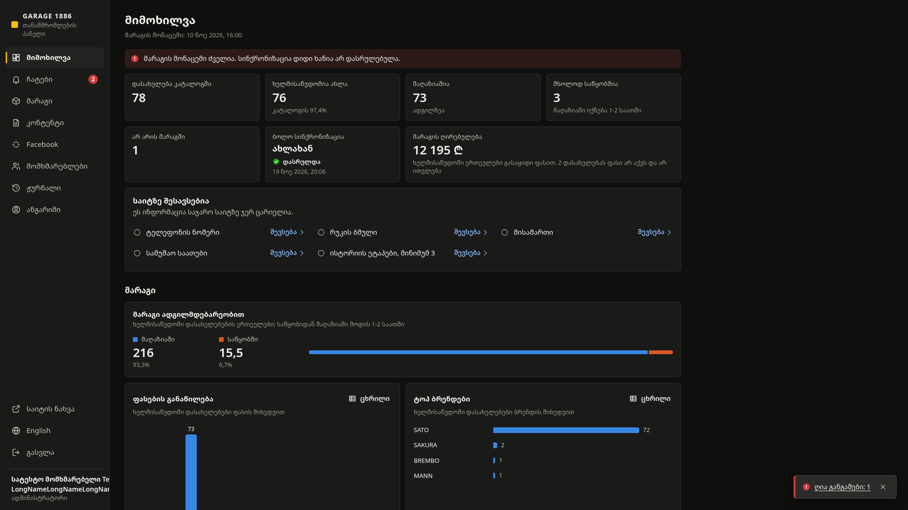
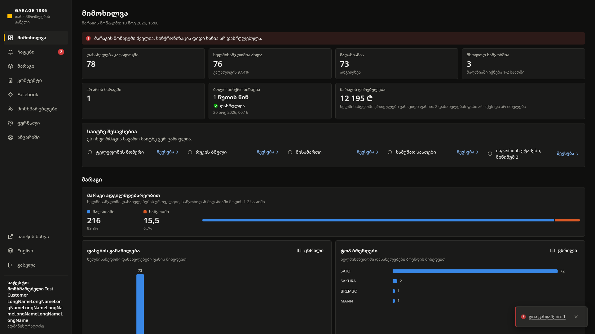
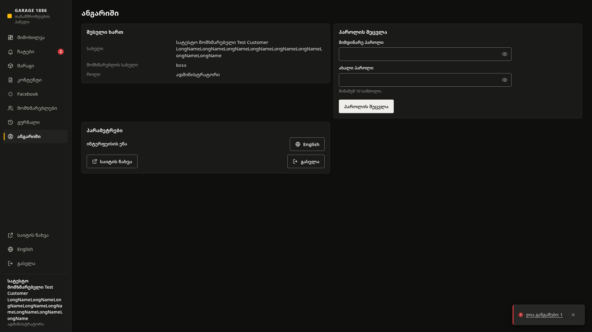
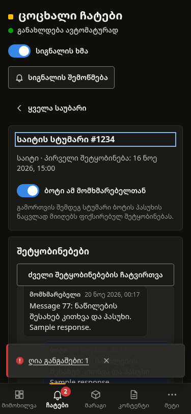
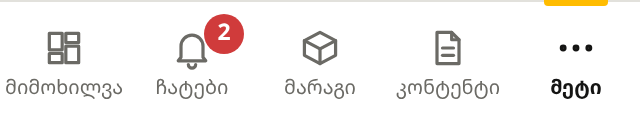

# Staff dashboard: full width and phones (QA, 2026-11-19)

Request: "fix all pages, make sure they are all fullscreen, make sure everything works
perfectly on mobile as well" (staff dashboard, `/admin`). "Fullscreen" means the pages fill
the browser window, not the browser's fullscreen mode.

## What changed

Cause: one shared rule, `.main { max-width: 1240px }`, left the right part of a wide screen
empty on every page; Account and More were also held to 560 px.

- `automotive/static/admin/css/admin.css`
  - The 1240 px limit is gone: pages use the whole width beside the 232 px sidebar and fill
    at least the window's height.
  - Overview's chart pairs stay at two columns at most (`.grid--2`, measured from the page
    width after the sidebar), so ultrawide screens do not get three narrow charts.
  - Account and More are two-column card grids on wide screens and one column on phones;
    form fields stay at most 560 px wide.
  - Long names, links and part codes wrap instead of pushing the page sideways: Live chats,
    Facebook chats, Users, More and inventory cards. Buttons are never wider than their row.
    The action rows on comment, gallery, Page and Ads cards (`.photo__actions`) wrap on
    narrow phones.
  - Live chats: the message list fits the visible screen above the phone tab bar, and only
    the messages scroll. Before, it was capped at 64 % of the window (640 px at most). A
    short chat now leaves empty space below its messages, because the card keeps the
    screen's height; that is accepted for a steady layout.
  - Touch targets: the alarm toast's close button and "earlier alarms" now meet the 44 px
    minimum (they were 28 px).
  - Small phones:
    - Tab bar labels shrink slightly below 371 px, so the Georgian "მიმოხილვა" no longer runs
      off a 320 px screen; 375 px and wider are unchanged.
    - Label/value lists, such as Account's "მომხმარებლის სახელი", put the label above the
      value below 373 px, instead of splitting Georgian words in half.
    - On a 320 px screen, segmented switches size each option by its label, so Inventory's
      "ამოწურულია" fits.
- `automotive/static/admin/js/ui.js`
  - Dialogs follow the visible part of the screen while a phone keyboard is open, and are
    left alone while the page is pinch-zoomed.
  - New `revealCurrentTab()`: the Content and Facebook sub-tab strips (`views/content.js`,
    `views/facebook.js`) scroll sideways to show the current tab. Before, on a 375 px phone,
    Facebook's Comments, Page and Ads tabs opened with their own tab off-screen.
- `views/account.js`, `views/more.js`, `views/live.js`: class names for the layouts above.
- `tests/browser/admin_fixture_server.py`, `tests/browser/admin_responsive_walk.mjs`: a
  repeatable browser check (below). Nothing on the server side, no API, database or
  migration change.

A first version made every button shrinkable with labels that break anywhere. That broke
Overview's "Table" button into "Tabl / e" on desktop. It was caught by looking at the
screenshots, and the rule now only caps button width.

## How it was checked

`node tests/browser/admin_responsive_walk.mjs` starts a throwaway copy of the dashboard on
port 8792. It uses in-memory test data with long Georgian and English names and long links.
It never reads `.env`, the shop database, Facebook or the model. Then it drives Google
Chrome through Playwright.

- Every page, as owner and as employee, in Georgian (dark theme) and English (light theme),
  at 320×568, 375×812, 390×844, 768×1024, 1023×768, 1024×768, 1440×900, 1920×1080 and phone
  landscape 844×390: 666 page visits. The pages are Overview, Inventory, Live chats and both
  chat kinds, every Content editor, Services, Gallery, all six Facebook tabs and a Facebook
  chat, Users, Audit log, Account and More (owner-only pages for the owner).
  Each visit checks:
  - the page reaches the right edge;
  - it fills the window's height;
  - nothing sticks out sideways;
  - the sidebar shows from 1024 px and the tab bar below that;
  - every tab bar label fits in its slot;
  - the current sub-tab is visible;
  - every segmented-switch label fits;
  - there are no Content-Security-Policy violations.
- At 375 and 1440 px, as the owner, 60 interaction checks. Saves, uploads, switches and
  deletions are each confirmed by the server's reply; the rest check what the page shows.
  - Inventory: paging, search and URL, switching between cards and table when resized, and
    the empty result.
  - Content texts: the save bar stays above the tab bar; the unsaved-changes warning; saving.
  - Services: the language tabs on a phone, and the server refusing an empty service.
  - Services: create one, then delete it. The confirmation's button is reachable, and Escape
    puts focus back on the button that opened it.
  - Gallery: upload and the publish switch.
  - Live chats:
    - loading older messages keeps the reading position;
    - the live poll keeps focus and scroll;
    - the per-customer bot switch works;
    - the message list fits the screen;
    - on a phone, the back link and the browser's Back button work.
  - Facebook comment reply dialog: a keyboard-height window. The phone keyboard is
    simulated by changing `visualViewport` (resize, slide, pinch zoom).
  - Users: the add-user dialog.
  - Account: password validation, a password change (the session is rotated) and switching
    language.
  - Overview: the error state, Retry, and the loading skeleton.
- Accessibility scan (axe-core, WCAG 2.2 AA rules) on all 30 owner pages at 375 px.

Result of the final run: 5,432 checks. All layout, navigation, sub-tab, switch-label, CSP
and interaction checks pass, with no browser errors. The 3 failures are the accessibility
findings below, all older than this work, so the command still exits with code 1. The
supporting checks also pass:

- 525 tests in `tests/test_site_*.py` (23 skipped: they need the throwaway database);
- `node tests/admin_live_model_test.mjs`: 17 of 17;
- `ruff check tests/browser`;
- `node --check` on the changed scripts.

The automatic checks only measure layout, so screenshots were also reviewed by eye.

| Width | Language | Pages viewed |
| --- | --- | --- |
| 320 px | Georgian | Live chats list and chat, short chat, Facebook chat, comments, Page and Ads, Users, More, Account, Inventory, Gallery with photos, tab bar |
| 320 px | English | Gallery (empty), Facebook chats list |
| 844×390 | Georgian | A short chat in landscape |
| 1440 px | Georgian | Gallery with photos |
| 1920 px | English | Overview, Live chat, More, Inventory, Users, Facebook comments |
| 1920 px | Georgian | Account |

That review found five problems the automatic checks had missed:

- the "Table" button;
- the tab bar label;
- the Account labels;
- the Inventory switch;
- the hidden sub-tabs.

Measuring scripts confirmed each fix, and the last three are now in the walk. Not viewed:
most English pages at 320 px, and Georgian Overview and Facebook chats at 320 px. Those are
covered only by the automatic checks.

## Screenshots

Before, 1920 px: the content stops at 1240 px.

After, 1920 px: content reaches the right edge, charts stay two to a row.

## Not fixed: older findings

- Live chats: the message list is an `<ol role="log">`, so screen readers lose the list
  around its messages (axe `listitem`). This is from the uncommitted Live chats work.
  Moving `role="log"` to a wrapper would fix it.
- Facebook → Ads at 375 px: the table's sideways-scrolling area cannot be reached with the
  keyboard (axe `scrollable-region-focusable`). A `tabindex="0"` with a label on
  `.table-wrap` would fix it.
- On a phone, the alarm toast sits just above the tab bar for 14 to 20 seconds. That is the
  same spot as a text editor's save bar, so staff may need to close the toast before saving.

## Limits

- Only Google Chrome was tested, with phone screen sizes emulated. Not tested: Safari or
  WebKit, Firefox, or a real phone. The keyboard behaviour was simulated, not typed on a
  device keyboard. Before calling it final, check on one iPhone (Safari) and one Android
  phone: Live chats, a text editor's save bar, and a dialog with the keyboard open.
- The shop on port 8767 serves these files directly from this working tree, so the changes
  are already live for staff. Nothing is committed.
