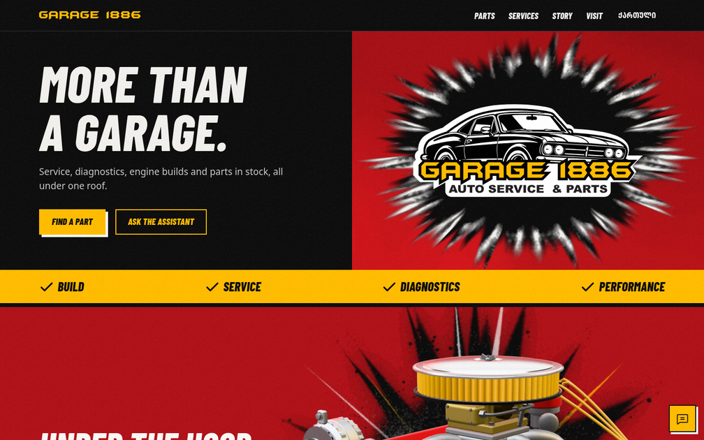
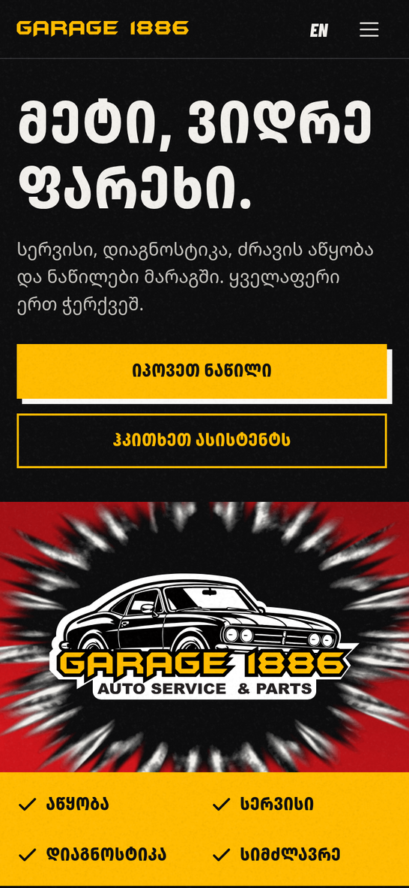
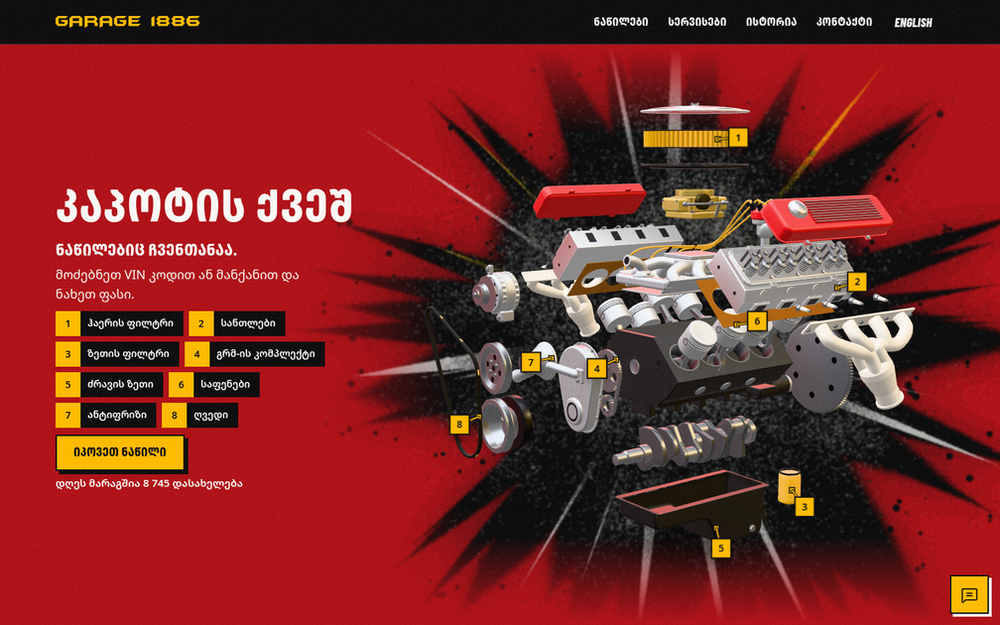
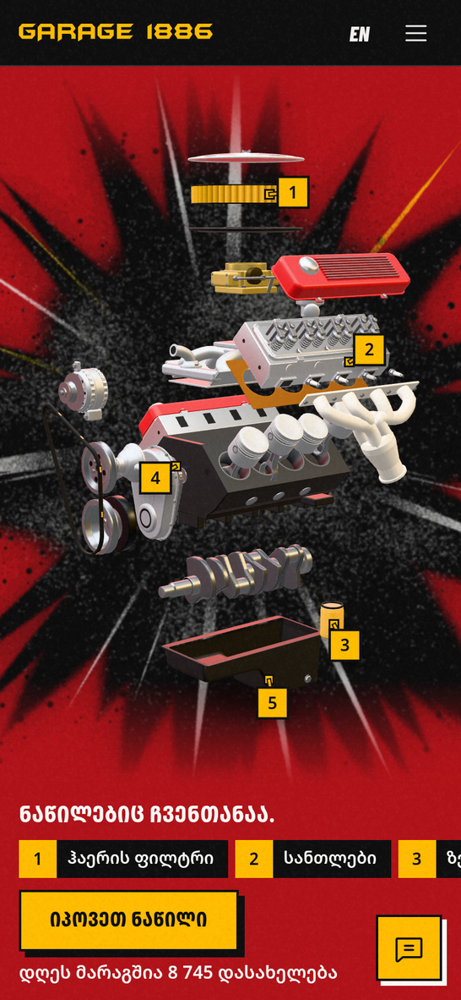
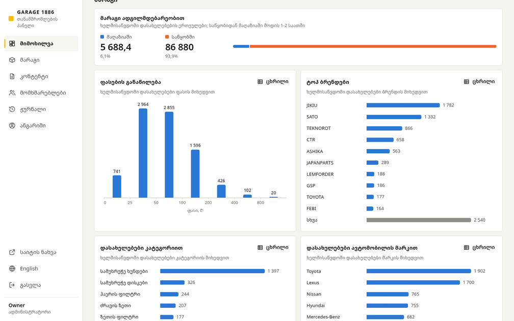
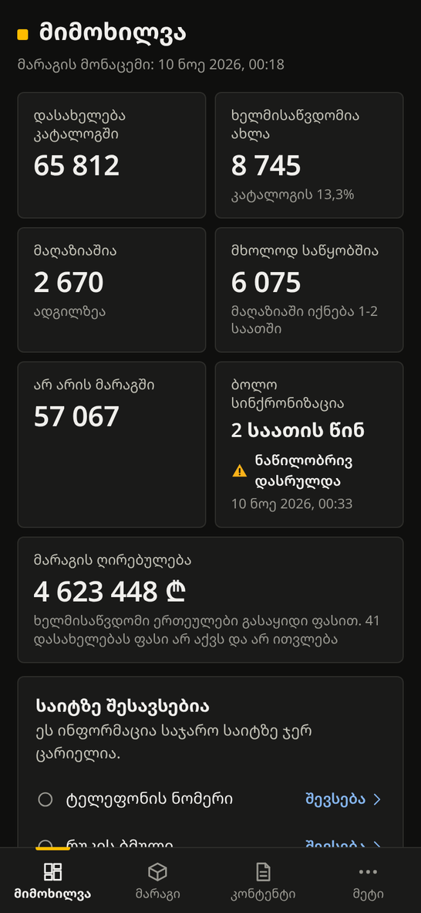
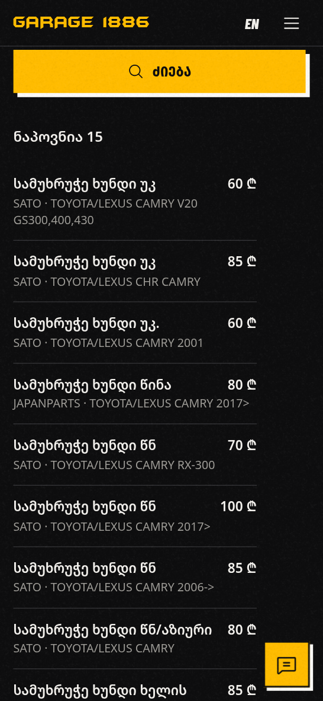

# Garage 1886 site: review and verification (2026-11-10)

What was built, how it was checked, and what was not. Live and simulated results are kept
apart, as in the other notes in this folder. Everything ran locally against the dev
database (65,812 catalogue items, 8,745 available); nothing is deployed.

| | Desktop 1440x900 | Phone 390x844 |
|---|---|---|
| Landing page |  |  |
| Engine section, exploded |  |  |
| Dashboard overview |  |  |

Part search results on a phone: 

## Automated checks

| Check | Result |
|---|---|
| `uv run python -m unittest discover -s tests` | 1047 tests pass, 52 skipped (database and loopback gated) |
| `tests.test_site_database` with a disposable admin URL | 18 pass: all 12 migrations apply as superuser and under `warehouse_migration_owner`, down then up works, grants and row-level security hold |
| `uv run ruff check automotive tests/test_site_*.py scripts` | clean (repo-wide Ruff still reports the 39 older `db_ui` errors) |
| `uv run bandit -q -r warehouse_sync automotive` | clean |
| `node tests/site_engine_timeline_test.mjs` | 36 pass |
| `node tests/automotive_chat_ui_test.cjs`, `node tests/automotive_ui_test.cjs` | pass (the staff workspace is unchanged apart from sending its session cookie) |
| `python3 -I scripts/vendor_site_assets.py check` | 13 modules: hashes, import graph, one URL per module, CSP patterns |
| `uv lock --check` | in sync (one new dependency, `jinja2`) |
| `uv run pip-audit` | `jinja2` is clean. Four packages that were already in the lock are flagged and were left alone: `lxml` 5.4.0, `pytest` 8.3.5, `python-dotenv` 1.2.1, `requests` 2.32.5 |

## Live checks in headless Chrome 151 (real server, real data)

- **Landing page**, Georgian and English, at 320x568, 360x640, 390x844, 412x915, 768x1024,
  1024x768, 1280x800 and 1440x900: no horizontal overflow, the headline on two lines, both
  hero buttons inside the first viewport, the navigation on one line, nothing under 14 px,
  zero console errors and zero CSP violations, no `style=` or `<style>` in the served HTML,
  no dash characters in the visible text, and no link to `/login`, `/admin` or `/staff`.
- **Fonts:** the Georgian capitals and the `₾` sign render from the self-hosted files
  (`document.fonts.check`). Chrome does not uppercase Georgian with `text-transform`, so
  the display cut draws the capital form for each letter and the page text stays lowercase.
- **Part search:** by car, by VIN (two real look-ups against the vehicle decoder), by
  Georgian and English keyword, by brand, by part code and by OEM code. Each response item
  has exactly `name`, `fits`, `brand` and `price`. Clicking a numbered part in the engine
  legend fills the search and runs it (227 results for "air filter" on the final check).
- **Chat:** one real exchange through the public endpoints returned in 12 s with only the
  whitelisted fields; the staff chat gave the same answer to the same question.
- **Engine:** reaches the 3D state on hardware GL; the frame at a given scroll position is
  pixel-identical scrolling down and back up; a lost WebGL context falls back to the poster
  and recovers; reduced motion and no JavaScript show the two posters with the legend;
  software renderers stay on posters. Desktop 58 draw calls and 91,422 triangles, phone 44
  and 60,812.
- **Lighthouse 12.8.2, mobile preset, three runs each:** `/` 99, 99, 100 and `/en` 99, 99,
  99; blocking time 0 ms; layout shift 0; the largest contentful paint is the headline at
  about 2.0 s. Before the engine start-up was deferred and chunked, `/` scored 63 to 70
  with 7 s of blocking time. Accessibility, best practices and SEO scored 100. One more
  run of each page after the final changes gave the same figures.
- **Scroll under 4x CPU throttle at 390x844:** 3D ready 1.6 s after the first touch, no
  task over 50 ms during the scroll.
- **Sign-in and dashboard:** both roles sign in; the employee sees three areas and gets
  `ADMIN_ONLY` elsewhere; texts, services, gallery upload (re-encoded in the browser),
  accounts and password change were exercised against the real API and restored; a write
  without the CSRF header or without an `Origin` header is refused; `/staff` and `/api/v1`
  answer only with a session.
- **The chat button and what sits under it (final pass).** On phones the last lines of
  the pinned engine caption ran under the chat button. They now wrap before it. Checked at
  320, 360, 375, 390, 412, 430, 600, 768, 844x390, 1024, 1280 and 1440 px in both
  languages: no text of the engine section under the button, nothing cut off, and at the
  end of the page nothing rests under it either. While a result list scrolls past, no
  price is ever under the button.
- **Phone flows (390x844):** the menu opens with four section links and the language
  switch and no sign-in link; a search by name lists results with prices first, written
  `25 ₾` in Georgian and `₾25` in English; the chat opens as a full-height sheet with a
  16 px field, and its example text is fully visible down to 320 px.
- **Dashboard on phones (320 and 390 px, both roles, every view):** no sideways overflow,
  nothing under the tab bar at the end of a view, no text cut off, no console errors.
- **Device profiles (final pass).** Twelve phone and tablet profiles (screen size, pixel
  density, touch, user agent) in both languages, in Chrome 151 on this machine's graphics
  card: Galaxy S9+, iPhone SE, Galaxy S8, iPhone 14, Pixel 7, iPhone 14 Pro Max, the same
  phones held sideways, and iPad Mini both ways. For each: headline in at most two lines
  and both buttons on the first screen, no sideways overflow anywhere, nothing cut off or
  under 14 px, every reveal ran, the engine pinned and following the scroll down and back
  in its 3D form, nothing under the chat button, twenty search results with no price under
  the button, the menu, and the chat as a full-screen sheet or a panel. All 24 runs pass.
- **Phones held sideways** were the one thing this pass changed. The hero used to stack
  as in portrait, which left its buttons below a 360 px tall screen. It now sets the copy
  and the logo side by side and sizes the headline by the height it has. On the smallest
  one (568x320) a numbered pin of the engine came under the chat button; the button now
  steps aside for it.
- **The engine on a real graphics card.** With nothing forced, Chrome on this machine's
  Intel Arc card starts the 3D scene by itself (58 draw calls, 91,422 triangles on a
  desktop; 44 and 60,812 on a phone). Frames at 3, 25, 45, 60 and 80% of the section are
  the same on the way back up as on the way down, and the engine is whole again at the top.
- **WebKit 2.52.5, the engine Safari is built on**, as installed on this system
  (WebKitGTK), in a window on a hidden display with its process sandbox as shipped: iPhone
  SE, iPhone 14 and iPhone 14 Pro Max sizes upright, two of them sideways, and iPad Mini,
  in both languages. The same checks as the device profiles above; all 12 runs pass, with
  the engine in its 3D form. One thing showed up only at the height Safari leaves on an
  iPhone 14 (664 px): the chat button sat on the end of the logo on the first screen. The
  button now steps aside for the logo as it does for buttons and prices.
- **Firefox 153** (its own engine), driven through its automation port at 500 px wide,
  the narrowest window it allows and inside the phone layout: first screen, fonts, the
  band's check marks, no sideways overflow, all sections, the engine in 3D and following
  the scroll, a part search with prices, and the chat as a full-screen sheet that gives
  its history entry back when closed all pass, in both languages, three runs in a row.
- **Under a finger (final pass).** Real touch input, sent through Chrome's input pipeline
  as raw touch points, on iPhone 14, Galaxy S8 and iPhone SE profiles: a finger drags the
  page from the first screen to the engine; a drag that starts on the 3D picture scrolls
  the page (the picture does not swallow the touch) and takes the engine apart, and the
  way back puts it together; a flick carries on by momentum and comes to rest; taps open
  and close the menu and the chat (44 px targets, 56 px for the chat button); the row of
  numbered parts and the photo row slide sideways without moving the page; a tap on a
  numbered part runs the search; the page can be zoomed with two fingers. All 42 checks
  pass.
- **The chat sheet and the phone keyboard (final pass, simulated).** A phone's keyboard
  does not resize the page: only the visible part shrinks, and the browser may slide it
  up to the field and back. No real keyboard can be raised on this machine, so the
  figures a phone reports were substituted and its two events fired. That showed a
  defect: the sheet followed a change of size but not a slide, so when the slide came
  after the resize the sheet stayed behind, and after the keyboard went away its message
  box could be left below the screen. The sheet now follows both, and is left alone
  while the page is zoomed with two fingers. The same steps are part of every device
  profile run above and of the WebKit runs, and pass in all of them.

## Security review

Two independent reviews were run on the finished code, the second on the fixes made after
the first. Everything they confirmed was fixed and has a regression test; what was left
as it is, is written down in [garage-site.md](../garage-site.md) under "Security model".

- First review, 13 findings (1 high, 4 medium, 8 low). The high one: an asset could be
  reached under a second spelling of its path, which also reached the authoring harness
  and let memory grow. Assets are now served only under the exact name the folder lists.
  The others: database queries a visitor could cause without limit, sign-in attempts
  queueing on worker threads, a public origin without a trusted proxy, a lock on the
  account that anyone could trigger, and smaller items.
- Second review, of those fixes: the new limit on session look-ups could itself hold up
  staff who share an address with someone sending invented cookies, and slow look-ups
  could take the worker threads. A session that was valid is now re-checked freely, only
  wrong cookies are charged, and only four unknown ones are looked up at once. It also
  found packaged photos marked unpublished reachable as plain assets (now not served),
  and that removing part numbers from chat sentences deleted oil approvals. That removal
  is now limited to the shop's own stock numbers.
- Checked live after the last change, without signing in: second spellings of asset
  paths, the authoring harness, unpublished packaged photos, build records, unknown
  `/api` paths and guessed image addresses all answer 404; thirty-six invented session
  cookies are answered and then refused while a signed-in session at the same address
  keeps working.

## Checked with simulated responses only

Dashboard sales and chat line charts with a month of data (one day of real data exists, so
the real page shows a "collecting since" state), version conflicts, 429 and 500 responses,
server-refused uploads, the last-admin refusal, and chat replies carrying part cards, quick
replies and "show more". The chat's shortcut to the part search (shown under an answer
that lists no parts) was checked the same way on a phone and a desktop in both languages.

## What the assistant answered

The widget shows exactly what the staff assistant answers; the same questions were put to
both and the answers matched. On 2026-11-10, with AI orchestration on:

- Asked for a part by number (a stock number, and a manufacturer's number): it answered
  in one second with the part, its price and whether it is in the store.
- Asked by make, model and year ("Toyota Camry 2015, front brake pads"): it replied that
  it could not confirm an offer yet and listed no parts, although the part search lists
  15 brake pads for that car. A question without the make was answered with "which make?".

The assistant itself was not changed by this work. Until it handles questions by car, the
part search is the dependable way to find a part, which is why the widget points there
when an answer lists nothing, and the chat can be switched off in the dashboard.

## Second batch of wall photos (later the same day)

The owner sent five more photos. One is the wall that tells in paint where the name comes
from (the year 1886, a crown, a portrait of Karl Benz and the story of his patent). It now
stands beside the story text, cut to the paint and set on the yellow stripe, and is in the
gallery, published. The other four show Ferrari or Pakelo marks (three are second shots of
walls already packaged) and went into the gallery unpublished, by the same rule as before.

- **Nothing else moved.** Rebuilding the photos left every existing image byte-identical
  (SHA-256 of all 30 files compared before and after); `build_site_assets.py check` now
  reports 39 recorded files.
- **Story section in headless Chrome 151, motion on:** 20 sizes from 320x568 to 1920x1080,
  four of them phones held sideways, both languages, each with and without a three-step
  timeline stood in for the milestones that are still empty (80 runs). In every run: no
  sideways overflow, the photo loaded and fully revealed with nothing left clipped, no
  text under 14 px, no console error or refused request. From 720 px up the words stand
  beside the wall and are centred on it, with the heading on the services heading's left
  edge; below that the wall follows the words. On a sideways phone the wall and its stripe
  fit in the height the navigation leaves.
- **WebKit 2.52.5** (WebKitGTK, as in the earlier pass): phone upright, sideways, tablet
  and desktop sizes in both languages, with and without a disk cache. In 38 of 39 runs
  the photo was revealed, about 0.2 s after it came into view where that was timed. In
  the first run at the one size where the hidden display resizes the test window
  (768x1024 becomes 768x920) it was still hidden when measured; the scroll position was
  not recorded in that run, and nine further runs at that size did not repeat it.
- **What is public:** the four unpublished photos answer 404 both as packaged files and
  by their hash; the 1886 wall answers 200.
- **`--add-photos`** was run against the local database: 5 added, 1 shown; a second run
  added nothing.
- 1057 tests pass, 53 skipped (the database-gated ones had no disposable database here);
  Ruff and Bandit are clean on the changed files.
- Not checked for this change: Firefox, and a real phone.

## Not verified

- A phone in the hand. None was attached to this machine and no phone emulator is
  installed, so everything above ran in desktop builds of the three browser engines at
  phone sizes, with touch input real and the keyboard simulated as described. Still to be
  seen on a real device: a real keyboard with the chat sheet, the address bar that
  shrinks while the engine stage is pinned, the notch and home-bar insets, the Android
  back gesture, in-app browsers (Facebook, Instagram), and frame rate and heat on a
  low-end phone.
- Safari itself on an iPhone. Its engine was tested (see WebKit above), but not Apple's
  own browser around it. Nothing in the page depends on a feature Safari lacks: the
  scroll-drawn history line is behind a feature test and simply stays drawn where it is
  not supported.
- To look at it on an Android phone without opening the server to the network: connect
  the phone by USB with USB debugging on, run `adb reverse tcp:8767 tcp:8767` on this
  computer, and open `http://127.0.0.1:8767` in the phone's Chrome. Not tried here
  (`adb` is not installed).
- Screen readers beyond roles, labels and focus order.
- Georgian interface wording: written to be plain, not yet reviewed by a native speaker.
- Anything about a public deployment: see "Before it is reachable from the internet" in
  [garage-site.md](../garage-site.md).

## Content that is still empty

Phone, address, map link, opening hours, history milestones and service prices are the
owner's to enter; the dashboard overview lists them. Until then the Visit section shows a
short "details are being added" message and the Call button is hidden. Three of the twelve
packaged shop photos are published; the nine that show other companies' marks are in the
gallery unpublished.
